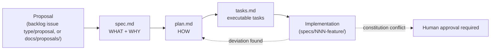

# Proposal → spec → plan → tasks → implementation lifecycle

BELAY practises Spec-Driven Development (SDD) with [GitHub Spec Kit](https://github.com/github/spec-kit)
1.4.2. Spec Kit is set up for Claude Code with PowerShell scripts, and its `git` and `agent-context`
extensions are installed. Every way this repository customises Spec Kit, and the guard that keeps the
customisations, is on [the Spec Kit page](../runbooks/spec-kit.md).

1. **Proposal**: an idea or design captured before it has a feature number. It has two homes:
   - **The issue backlog** (feature 014): an issue labelled `type/proposal`, filed from a Claude Desktop session
     through the `pdlc` server or through the proposal web form. A draft (`status/proposal-draft`) is shaped there;
     a ready one (`status/needs-spec`) is picked up with `backlog.mjs show <n>` and fed to `/speckit-specify` as
     `Proposal #<n>: <title>` plus its body. Or, from Claude Desktop (feature 016), the `pdlc` server writes and
     clarifies the spec with the repository's own Spec Kit and publishes it on its feature branch.
     **The issue then follows the feature through stages, one label at a time, and stays open**: `spec-in-progress`
     (the mandatory `after_specify` hook, or `start_spec`), `ready-to-plan` (approved in Claude Desktop; `ready`
     lists it with its branch, which is checked out and planned), `in-engineering` (the mandatory `after_plan`
     hook), and `merged`, when **only the merge closes it**, in CI's `feature-merged` workflow, with the count of tests
     the feature created. Each move posts a comment ending in a `pdlc-stage` trailer first and changes the label
     second ([the backlog](../runbooks/backlog.md); contract `specs/016-pdlc-spec-intake/contracts/stages.md`).
   - **`docs/proposals/**`**, kept for history and for long research documents (FR-027), with the pre-Spec-Kit
     design record and plan in `specs/000-new-repo-setup/`.

   Once a numbered `specs/NNN-feature-name/` folder exists, the spec is the source of truth; a backlog proposal
   stays open as the feature's tracking issue until the merge.
2. **`spec.md`**: WHAT and WHY only, meaning user stories, functional requirements and domain terms.
   It stays technology-agnostic.
3. **`plan.md`**: HOW, meaning the stack, libraries and approach.
4. **`tasks.md`**: the executable breakdown, generated from the project's tasks-template override.
   It carries the doc-impact sweep, test pairs in Verify RED / Verify GREEN format, a close-out
   re-search and an **Open the PR** task.
5. **Implementation.** If it deviates from `plan.md` or `tasks.md`, update them to match. A
   deviation from the **constitution** needs human approval.

## Which changes need a spec

**Code under `backend/`, `frontend/`, `agents/`, `mcp-servers/`, `packages/`, `tools/` or
`infrastructure-as-code/` needs an existing `specs/NNN-*/` spec, plan and tasks set.** Write it first,
or stop and ask. A new tool or gate under `scripts/` normally goes through a spec too: features 001 to
003 did. A small, tested addition to an existing tool may go straight to a branch and a PR when the
maintainer agrees, as `taskstoissues.mjs` did in PR #27.

**Exempt:** proposals, documentation, and knowledge or index edits (`docs/`, `openwiki/`,
`AGENTS.md`).

## The commands, in order

1. `/speckit-constitution`
2. `/speckit-specify`. Its mandatory `before_specify` hook creates the feature branch; its mandatory `after_specify`
   hook moves a source proposal to `spec-in-progress`.
3. `/speckit-clarify` (optional)
4. `/speckit-plan`. Its `before_plan` hook writes `.specify/feature.json`, so a branch checked out from Claude Desktop
   plans without a fix-up; its mandatory `after_plan` hook moves a source proposal to `in-engineering`.
5. `/speckit-checklist` (optional)
6. `/speckit-tasks`
7. `/speckit-analyze` (optional)
8. `/speckit-implement`

`/speckit-converge` appends tasks for work that is still missing from the codebase, in the same test
format. `/speckit-taskstoissues` mirrors `tasks.md` into the Forgejo backlog (see
[the backlog](../runbooks/backlog.md)).

## Gotchas

- **A proposal is not a source of truth once a spec exists.** Treat any detail that survives in it as
  history. That is why `docs/proposals/**` and `specs/` are excluded from this wiki.
- **A spec records a decision at the time, not the current state.** Specs are not updated when later
  work supersedes them. When a spec disagrees with a runbook or the code, the later source wins.
- **agent-context owns a region of `AGENTS.md`.** After `/speckit-specify` and `/speckit-plan`, the
  `agent-context` extension writes a pointer to the current plan between `<!-- SPECKIT START -->` and
  `<!-- SPECKIT END -->` in `AGENTS.md`, appending the region if it is absent. Never edit inside it
  by hand. It writes to `AGENTS.md`, never to the `CLAUDE.md` shim.
- **The Spec Kit scripts are PowerShell only.** The repository was initialised with `--script ps`.
  Without `pwsh`, resolve the feature directory from `.specify/feature.json` by hand.
- **Hooks run without asking** (`auto_execute_hooks: true`). See
  [instrument traps](../gotchas/instrument-traps.md).
- **Task IDs are not always three digits.** Remediation and split tasks take a letter suffix
  (T044a). Search `tasks.md` with a pattern that allows one.
- **When the behaviour under test already exists, a compile error is not an acceptable RED.** Use a
  mutation RED: apply a named source edit, watch the test fail, then revert the edit (see
  [test authoring conventions](./test-authoring-conventions.md)).

For the state of a feature, start with its `specs/NNN-feature-name/` folder. A `HANDOFF*.md` file,
where present, captures in-flight state. When there are several, the later one is authoritative.
